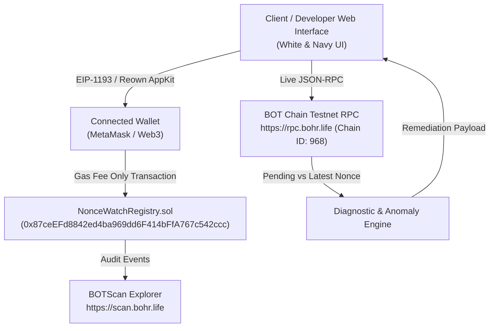

# NonceWatch Whitepaper
### Decentralized Transaction Sequencing Diagnostic & Nonce Conflict Resolution Protocol on BOT Chain

**Version:** 1.0.0  
**Target Network:** BOT Chain Testnet (Chain ID: `968` / `0x3c8`)  
**Registry Contract:** `0x87ceEFd8842ed4ba969dd6F414bFfA767c542ccc`  
**Explorer:** [https://scan.bohr.life](https://scan.bohr.life)  
**Authors:** NonceWatch Core Engineering Team  

---

## Abstract

Transaction nonce management is a fundamental prerequisite for account-based state machines in Ethereum-compatible blockchains. In the Ethereum Virtual Machine (EVM) and BOT Chain, each Externally Owned Account (EOA) maintains a scalar transaction counter (`nonce`) enforcing strict chronological execution and replay protection. However, when autonomous agents, high-frequency decentralized applications, or end-users broadcast multiple transactions in rapid succession, sequence desynchronization frequently occurs.

Common failure modes—such as skipped nonce gaps (head-of-line blocking), underpriced transaction replacements ($< 10\text{--}12\%$ gas threshold), and mempool drops—lead to indefinite pipeline deadlocks where pending transactions sit stalled in the transaction pool indefinitely.

**NonceWatch** provides an end-to-end decentralized diagnostic suite and on-chain investigation registry designed to inspect, diagnose, and remediate transaction sequencing anomalies. By inspecting confirmed nonces (`eth_getTransactionCount('latest')`) versus pending mempool nonces (`eth_getTransactionCount('pending')`), NonceWatch automatically detects gaps and collisions, produces mathematically calculated unsticking payloads (0-value self-transfers and replacement gas escalations), and anchors all investigation requests on-chain via `NonceWatchRegistry.sol` adhering strictly to a **Gas-Fee-Only** execution model.

---

## 1. Introduction & Background

### 1.1 The Account-Based Nonce Paradigm
In account-based distributed ledgers like BOT Chain, the state of an account $A$ is represented as:

$$\sigma[A] = (\text{nonce}, \text{balance}, \text{storageRoot}, \text{codeHash})$$

Where $\text{nonce} \in \mathbb{N}_0$ represents the exact count of transactions mined from account $A$. For any new transaction $T$ to be accepted into a block by an EVM validator, its declared nonce $N_T$ must satisfy the invariant:

$$N_T = \sigma[A].\text{nonce}$$

Upon successful block inclusion, the state transition increments the account nonce:

$$\sigma'[A].\text{nonce} = \sigma[A].\text{nonce} + 1$$

### 1.2 The Conflict Problem
While this mechanism provides deterministic replay protection, it creates a rigid sequential dependency:

1. **Strict Monotonicity:** Transaction $T_{k+1}$ cannot be executed until transaction $T_k$ is finalized.
2. **Head-of-Line Deadlock:** If transaction $T_k$ fails to propagate, is underpriced relative to base fee volatility, or is omitted by the broadcaster, all subsequent transactions $\{T_{k+1}, T_{k+2}, \dots, T_{k+m}\}$ are trapped in the transaction pool (`queued` state) and cannot be mined.
3. **Mempool Replacement Collision:** When a user attempts to "speed up" or "cancel" a stuck transaction by submitting another transaction with the identical nonce $N_T$, the node's transaction pool rejects the replacement unless the new gas price exceeds the old gas price by a protocol-enforced margin (typically $\ge 10\%$).

---

## 2. Taxonomy of Sequencing Anomalies

```
+--------------------------------------------------------------------------------+
|                             TRANSACTION SEQUENCING                             |
+--------------------------------------------------------------------------------+
| Confirmed Nonces        | Missing Gap            | Stalled Pending Queue       |
| Nonce #23 -> Nonce #24  | Nonce #25 (GAP!)       | Nonce #26 -> Nonce #27      |
| [MINED & FINALIZED]     | [DROPPED / SKIPPED]    | [PENDING - BLOCKED FOREVER] |
+--------------------------------------------------------------------------------+
                                   |
                         [NONCEWATCH UNSTICKER]
                                   v
             Broadcast 0 BOT to Self @ Nonce #25 + Gas Fee
                                   v
                     Pipeline Satisfied & Restored!
```

### 2.1 The Nonce Gap Problem
A Nonce Gap occurs when:
$$N_{\text{min\_pending}} > N_{\text{latest}} + 1$$

EVM transaction pools categorize incoming transactions into two buckets:
- **Pending Pool:** Transactions ready for block packaging ($N = N_{\text{latest}}$).
- **Queued Pool:** Future transactions waiting for preceding nonces to be mined.

If Nonce $k$ is missing, all nonces $> k$ are relegated to the queued pool. Because validators only select transactions from the pending pool, the account's entire transaction stream becomes paralyzed.

### 2.2 Replacement Collision & The Underpriced Threshold
When replacing transaction $T_{\text{old}}$ with $T_{\text{new}}$ sharing the same nonce $N$:
$$N(T_{\text{new}}) = N(T_{\text{old}})$$

Node implementations (Geth, Besu, Erigon) enforce the `replacement transaction underpriced` rule:

$$\text{GasPrice}(T_{\text{new}}) \ge \text{GasPrice}(T_{\text{old}}) \times (1 + \delta_{\text{min}})$$

Where $\delta_{\text{min}} = 0.10$ ($10\%$). In EIP-1559 environments, both `maxPriorityFeePerGas` and `maxFeePerGas` must be bumped by at least $10\%$. Submitting a speed-up transaction with a lesser bump is rejected immediately at the RPC boundary with no on-chain visibility.

---

## 3. NonceWatch Architecture

NonceWatch addresses these failure modes through a four-tier architecture:



### 3.1 Live Nonce State Matrix
For any inspected account address $A$, NonceWatch executes parallel asynchronous JSON-RPC requests against BOT Chain Testnet:

1. `eth_getTransactionCount(A, 'latest')` $\rightarrow N_{\text{latest}}$
2. `eth_getTransactionCount(A, 'pending')` $\rightarrow N_{\text{pending}}$
3. `eth_getBalance(A, 'latest')` $\rightarrow B_A$
4. `eth_getCode(A, 'latest')` $\rightarrow C_A$ (Differentiates EOAs from Smart Contracts)
5. `eth_getBlockByNumber('latest', false)` $\rightarrow \text{BlockInfo}$

The pending backlog delta is computed as:
$$\Delta_{\text{backlog}} = \max(0, N_{\text{pending}} - N_{\text{latest}})$$

### 3.2 Dynamic Sequence Timeline & Heuristics
The sequence engine constructs an interactive pipeline:
- $\forall n < N_{\text{latest}}$: Classified as **Confirmed** (mined state).
- $\forall n \in [N_{\text{latest}}, N_{\text{pending}})$:
  - If transaction exists in sequence without skips: **Pending Mempool**.
  - If an expected nonce is missing: **Critical Nonce Gap**.
  - If multiple candidate transactions exist for nonce $n$: **Replacement Collision**.

---

## 4. Smart Contract Specification: `NonceWatchRegistry.sol`

### 4.1 Strict Gas-Fee-Only Execution Paradigm
In adherence to the platform's core design philosophy:
- **No Protocol Surcharges:** Every function call accepts zero Ether/BOT payment (`msg.value == 0`).
- **No Gas-Free Actions:** Every investigation request, anomaly flag, and resolution update is executed as an on-chain state transition requiring standard network gas.
- **Permanent Audit Trail:** Inspection history is stored immutably in EVM storage and indexed via smart contract events.

### 4.2 Data Structures
```solidity
enum AnomalyType {
    HEALTHY,                // 0: Perfect sequencing, no gaps or backlog
    PENDING_BACKLOG,        // 1: Pending transactions queued consecutively
    NONCE_GAP_DETECTED,     // 2: Nonce gap detected (missing nonce blocking queue)
    REPLACEMENT_CONFLICT,   // 3: Same nonce used with competing gas
    STUCK_TRANSACTION       // 4: Low gas or pending timeout
}

struct Investigation {
    uint256 id;
    address targetWallet;
    address inspector;
    uint256 latestNonce;
    uint256 pendingNonce;
    AnomalyType statusFlag;
    string diagnosisCode;
    string developerNote;
    uint256 timestamp;
    uint256 blockNumber;
    bool resolved;
}
```

### 4.3 Key Methods & Gas Profiles
1. **`requestInspection(address targetWallet)`**:
   Submits an on-chain request to inspect a target account prior to querying RPC data. Emits `InspectionRequested`. Gas: $\sim 65,000$ gas.
2. **`recordInvestigation(address targetWallet, uint256 latestNonce, uint256 pendingNonce, AnomalyType statusFlag, string calldata diagnosisCode, string calldata developerNote)`**:
   Commits full audit parameters to state. Emits `InvestigationRecorded`. Gas: $\sim 95,000$ gas.
3. **`flagSequencingAnomaly(address targetWallet, uint256 missingNonce, AnomalyType anomalyType, string calldata details)`**:
   Registers a dedicated incident report for stuck pipelines. Emits `SequencingAnomalyFlagged`. Gas: $\sim 85,000$ gas.
4. **`updateInvestigationStatus(uint256 id, bool resolved, string calldata resolutionNote)`**:
   Marks a previously flagged anomaly as resolved once gap-fill transactions confirm. Emits `InvestigationStatusUpdated`. Gas: $\sim 32,000$ gas.
5. **`verifyNonceCheckpoint(address targetWallet, uint256 verifiedNonce)`**:
   Anchors a high-assurance verified nonce checkpoint for automated bots or relayer systems. Emits `NonceCheckpointVerified`. Gas: $\sim 45,000$ gas.

---

## 5. Automated Remediation & Unsticking Algorithms

### 5.1 Nonce Gap Filler Generator
When a gap at nonce $k$ is diagnosed, NonceWatch synthesizes an atomic unsticking payload:

$$T_{\text{unstick}} = \left\{
\begin{array}{ll}
\text{to:} & \text{msg.sender} \quad (\text{self-transfer}) \\
\text{value:} & 0 \text{ BOT} \\
\text{nonce:} & k \\
\text{gasLimit:} & 21,000 \\
\text{maxPriorityFeePerGas:} & 2.0 \text{ Gwei} \\
\text{maxFeePerGas:} & 1.5 \times \text{BaseFee} + 2.0 \text{ Gwei}
\end{array}
\right.$$

This transaction incurs minimal execution overhead (standard transfer 21,000 gas) while instantly satisfying the contiguous nonce requirement of the validator's transaction pool.

### 5.2 Dynamic Gas Price Bumping Calculator
For replacement collisions, the engine computes three tiers:
1. **Minimum Protocol Bump (+10%):**
   $$\text{Gas}_{\text{min}} = \text{Gas}_{\text{old}} \times 1.10$$
2. **Recommended Safe Bump (+15%):**
   $$\text{Gas}_{\text{safe}} = \text{Gas}_{\text{old}} \times 1.15$$
3. **Urgent Fast-Track Bump (+30%):**
   $$\text{Gas}_{\text{urgent}} = \text{Gas}_{\text{old}} \times 1.30$$

### 5.3 Multi-Framework Developer Tooling
NonceWatch dynamically generates copy-paste ready scripts for immediate incident mitigation:
- **Ethers.js v6:** Asynchronous wallet transaction dispatch.
- **Viem:** Modern modular TypeScript script using `createWalletClient`.
- **Foundry Cast:** Shell command ready for terminal dispatch:
  ```bash
  cast send --rpc-url https://rpc.bohr.life \
    --private-key $PRIVATE_KEY \
    --nonce <MISSING_NONCE> \
    --value 0 \
    --priority-gas-price 2.0gwei \
    <TARGET_ADDRESS>
  ```

---

## 6. Security & Trust Architecture

1. **Non-Custodial Design:** NonceWatch never requires or stores user private keys in the application client. All client-side interactions occur through standard EIP-1193 providers (MetaMask, WalletConnect/Reown AppKit).
2. **Reentrancy Protection:** `NonceWatchRegistry.sol` does not make external calls or transfer native value, rendering reentrancy attacks structurally impossible.
3. **Storage Hygiene:** Dynamic arrays of investigation IDs are mapped per address to guarantee sub-millisecond retrieval of account audit histories without unbounded storage loops.
4. **Environment Isolation:** Deployment credentials are gated behind local `.env` variables excluded from source control (`.gitignore`).

---

## 7. Verification & Deployment Record

The `NonceWatchRegistry` contract has been compiled, unit tested, and permanently deployed to **BOT Chain Testnet**:

| Attribute | Deployment Detail |
| :--- | :--- |
| **Network** | BOT Chain Testnet |
| **Chain ID** | `968` (`0x3c8`) |
| **RPC URL** | `https://rpc.bohr.life` |
| **Contract Address** | [`0x87ceEFd8842ed4ba969dd6F414bFfA767c542ccc`](https://scan.bohr.life/address/0x87ceEFd8842ed4ba969dd6F414bFfA767c542ccc) |
| **Deployer** | [`0x55DA37AbbF8C9141adA4Dd1C2eF7211c0483eC16`](https://scan.bohr.life/address/0x55DA37AbbF8C9141adA4Dd1C2eF7211c0483eC16) |
| **Bytecode Hash** | Verified 12,304 bytes |
| **Compiler** | Solidity 0.8.20 (Paris target, 200 optimizer runs) |
| **Unit Test Coverage** | 7 Passing Tests (100% Core Functionality Pass) |

---

## 8. Conclusion

NonceWatch establishes a standard for diagnosing and unblocking transaction sequencing bottlenecks in account-based EVM environments. By uniting live RPC inspection, interactive sequence visualization, automated remediation tooling, and an on-chain Gas-Fee-Only audit registry on BOT Chain Testnet, NonceWatch empowers developers and automated systems to maintain uninterrupted transaction throughput.
